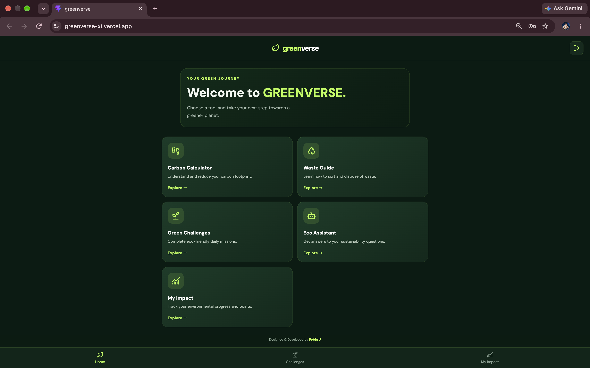
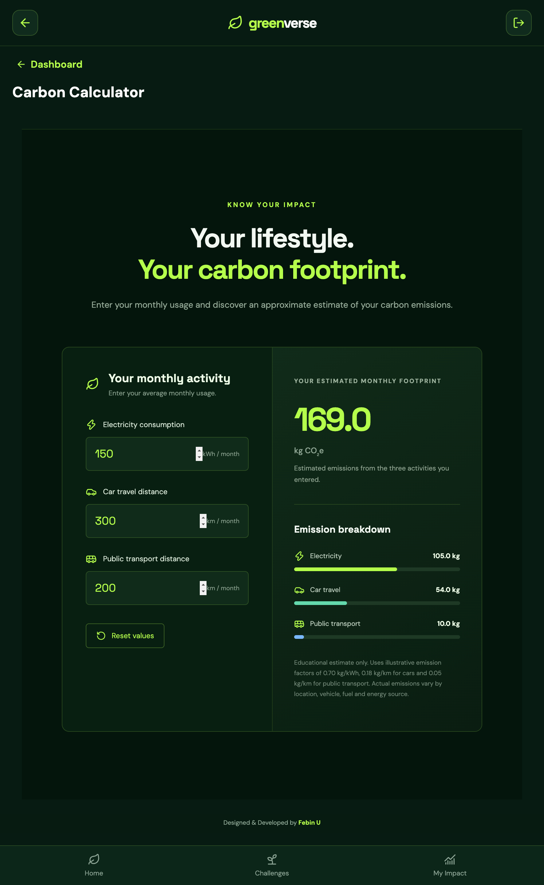
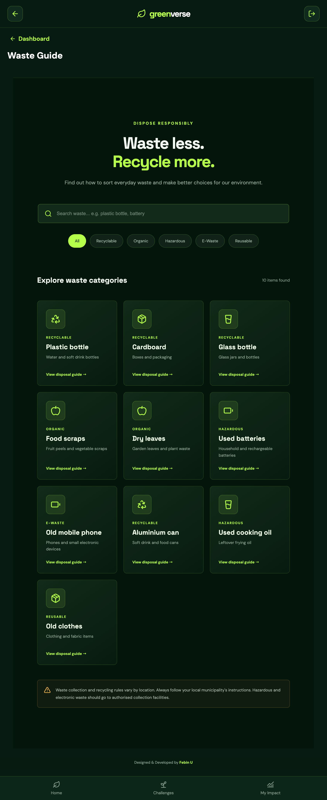
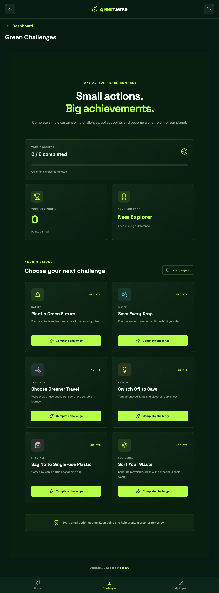
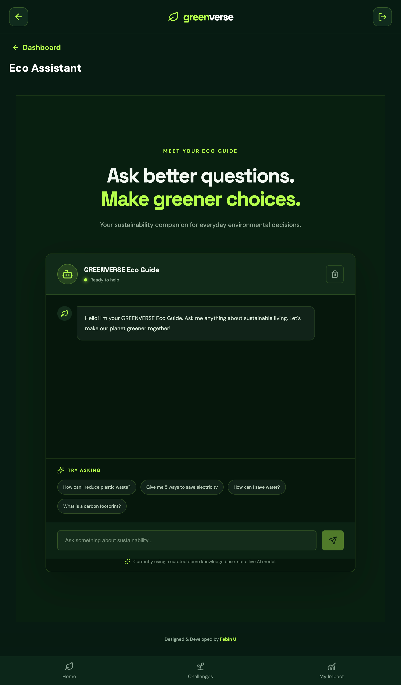
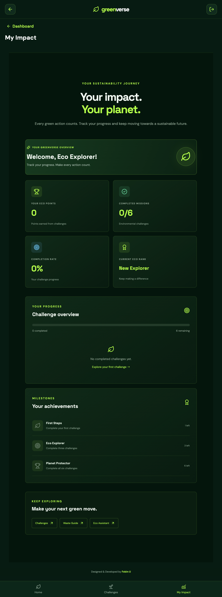

GREENVERSE

Technology Meets Sustainability

GREENVERSE is a sustainability-focused web application designed to encourage people to adopt environmentally friendly habits through interactive tools, challenges and accessible environmental guidance.

It aims to make sustainable living easier, more engaging and more accessible.

---

1. Project Overview

Environmental sustainability is an important global concern. Many people want to contribute to a greener planet but may not know where to begin.

GREENVERSE provides a digital platform that helps users understand their environmental impact and take small, meaningful steps towards sustainable living.

2. Key Features

User Authentication

- User registration and login.
- Guest access to explore the application.
- Supabase-powered authentication.

Green Challenges

- Explore eco-friendly challenges.
- Track completed challenges.
- Save challenge progress using Supabase.

Waste Guide

- Access guidance about waste management.
- Learn about responsible waste disposal and environmental practices.

Carbon Footprint Calculator

- Calculate estimated carbon footprint.
- Understand how everyday activities affect the environment.

AI Eco Assistant

- An interactive assistant for sustainability-related guidance.
- Helps users explore environmental topics and eco-friendly practices.

Login Activity Tracking

- Records login events.
- Differentiates between guest and email login activity.

---

3. Technology Stack

Technology| Purpose
React| Frontend user interface
Vite| Development and build tool
JavaScript| Application functionality
HTML5| Web page structure
CSS3| Styling and responsive design
Supabase| Authentication and database
Capacitor| Mobile application integration
Vercel| Website deployment
Git & GitHub| Version control and source code hosting

---

4. System Architecture

GREENVERSE follows a frontend-and-backend-as-a-service architecture.

Application flow:

1. Users access the GREENVERSE website.
2. React displays the application interface.
3. Supabase handles authentication and database operations.
4. Application features interact with the stored user data where applicable.
5. Vercel hosts the deployed web application.

---

5. Live Application

Live Website:
https://greenverse-xi.vercel.app/

GitHub Repository:
https://github.com/febin-u/GREENVERSE

---

6. Installation and Setup

Follow these steps to run GREENVERSE locally.

Prerequisites

- Node.js
- npm
- Git
- A Supabase account

Step 1: Clone the repository

git clone https://github.com/febin-u/GREENVERSE.git

Step 2: Open the project

cd GREENVERSE

Step 3: Install dependencies

npm install

Step 4: Configure environment variables

Create a ".env.local" file in the project root.

Add your Supabase project credentials:

VITE_SUPABASE_URL=your_supabase_project_url
VITE_SUPABASE_PUBLISHABLE_KEY=your_supabase_publishable_key

Replace the placeholder values with your own Supabase credentials.

Security: Never commit ".env.local" or expose Supabase secret keys in frontend code or GitHub.

Step 5: Start the development server

npm run dev

Open the local URL displayed in your terminal, usually:

http://localhost:5173/

---

7. Database and Backend

GREENVERSE uses Supabase for backend services.

The application uses:

- Supabase Authentication for user access.
- "login_events" for recording login activity.
- "user_challenges" for storing user challenge progress.
- Row Level Security (RLS) to restrict access to user-specific records.

---

8. Deployment

The web application is deployed using Vercel.

The project is connected to GitHub for source code management and deployment updates.

Deployment URL: https://greenverse-8s2pabc55-virus-52f6.vercel.app

---

9. Future Enhancements

Possible future improvements include:

- More interactive sustainability challenges.
- Advanced carbon footprint analysis.
- Environmental awareness campaigns.
- Additional personalized recommendations.
- Improved analytics and progress visualization.
- Expanded mobile application functionality.

---

10. Conclusion

GREENVERSE combines technology and environmental awareness to encourage sustainable lifestyles.

By bringing together interactive challenges, waste management guidance, carbon footprint calculation and AI-assisted environmental information, GREENVERSE aims to help users take meaningful steps towards a greener future.

GREENVERSE — Small Actions. Greener Planet.

---

Competition Information

Event: TERRACODE 2026
Organised by: FOSS Club, Department of Computer Science and Engineering, MEA Engineering College
Registration ID: TC-2026-AJZKUD
Project: GREENVERSE
Participant: Febin U
---

---

## Project Screenshots

### 1. GREENVERSE Dashboard

---

### 2. Carbon Calculator

---

### 3. Waste Guide

---

### 4. Green Challenges

---

### 5. Eco Assistant

---

### 6. My Impact

---
